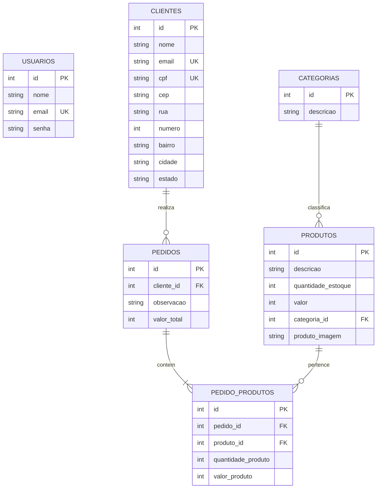

# 🛒 PDV - API de Frente de Caixa (Ponto de Venda)

[](https://nodejs.org/)
[](https://expressjs.com/)
[](https://www.postgresql.org/)
[](https://knexjs.org/)
[](https://jwt.io/)
[](https://www.npmjs.com/package/bcrypt)

> API RESTful robusta desenvolvida em Node.js e PostgreSQL para gerenciamento de fluxo completo de **Frente de Caixa (PDV)**, contemplando controle de usuários autenticados, catálogo e estoque de mercadorias com upload de imagens em nuvem (S3 / Backblaze B2), gestão de clientes e emissão de pedidos com validação de regras de negócio.

---

## 🎯 Sobre o Projeto

O **PDV (Frente de Caixa)** simula o backend de um sistema comercial de varejo. A API foi projetada para resolver problemas operacionais de lojas, integrando autenticação segura, integridade referencial em banco relacional e regras estritas para prevenção de inconsistências (como vendas sem estoque suficiente e exclusão indevida de dados vinculados).

### 💡 Principais Diferenciais Técnicos:
- **Autenticação & Autorização:** Proteção de rotas via tokens JWT (*Bearer Token*) e criptografia unidirecional de senhas com *Bcrypt*.
- **Validação Rigorosa de Dados:** Sanitização e validação de requisições com esquemas estruturados (*Joi*), impedindo inserções inválidas.
- **Gestão Consistente de Estoque:** Abatimento automático de mercadorias em transação no fechamento do pedido e bloqueio de vendas de itens indisponíveis.
- **Upload de Imagens em Nuvem:** Integração com armazenamento compatível com S3 (Backblaze B2 / AWS S3) via *Multer* para fotos de produtos.
- **Integridade de Dados:** Regras de negócio que impedem a exclusão de produtos que já possuem histórico em pedidos efetuados.
- **Notificação Transacional:** Disparo de e-mails para os clientes confirmando a realização e os detalhes de seus pedidos.

---

## 🏛️ Modelo Entidade-Relacionamento (Banco de Dados)



---

## 📡 Visão Geral dos Endpoints

### 🔐 Autenticação e Usuários
| Método | Endpoint | Descrição | Autenticação |
|---|---|---|---|
| `POST` | `/usuario` | Cadastra um novo usuário no sistema | Pública |
| `POST` | `/login` | Realiza autenticação e retorna Token JWT | Pública |
| `GET` | `/usuario` | Retorna o perfil do usuário logado | Bearer Token |
| `PUT` | `/usuario` | Atualiza dados do usuário logado | Bearer Token |

### 📂 Categorias
| Método | Endpoint | Descrição | Autenticação |
|---|---|---|---|
| `GET` | `/categoria` | Lista todas as categorias cadastradas | Pública |

### 📦 Produtos & Estoque
| Método | Endpoint | Descrição | Autenticação |
|---|---|---|---|
| `POST` | `/produto` | Cadastra um novo produto (aceita imagem opcional `produto_imagem`) | Bearer Token |
| `PUT` | `/produto/:id` | Atualiza dados e imagem de um produto | Bearer Token |
| `GET` | `/produto` | Lista produtos (com filtro opcional por `categoria_id`) | Bearer Token |
| `GET` | `/produto/:id` | Detalha as informações de um produto específico | Bearer Token |
| `DELETE`| `/produto/:id` | Exclui um produto (se não vinculado a pedidos) e remove sua imagem do storage | Bearer Token |

### 👥 Clientes
| Método | Endpoint | Descrição | Autenticação |
|---|---|---|---|
| `POST` | `/cliente` | Cadastra um novo cliente (valida CPF e e-mail únicos) | Bearer Token |
| `PUT` | `/cliente/:id` | Atualiza dados cadastrais de um cliente | Bearer Token |
| `GET` | `/cliente` | Lista todos os clientes cadastrados | Bearer Token |
| `GET` | `/cliente/:id` | Detalha informações de um cliente | Bearer Token |

### 🧾 Pedidos (Checkout)
| Método | Endpoint | Descrição | Autenticação |
|---|---|---|---|
| `POST` | `/pedido` | Emite pedido, valida estoque, atualiza saldo e envia e-mail | Bearer Token |
| `GET` | `/pedido` | Lista pedidos emitidos (com filtro opcional por `cliente_id`) | Bearer Token |

---

## 📋 Exemplo de Payload - Emissão de Pedido (`POST /pedido`)

**Requisição:**
```json
{
  "cliente_id": 1,
  "observacao": "Entregar em horário comercial",
  "pedido_produtos": [
    {
      "produto_id": 4,
      "quantidade_produto": 2
    },
    {
      "produto_id": 7,
      "quantidade_produto": 1
    }
  ]
}
```

**Resposta de Sucesso (`201 Created`):**
```json
{
  "pedido": {
    "id": 12,
    "cliente_id": 1,
    "observacao": "Entregar em horário comercial",
    "valor_total": 4500
  },
  "pedido_produtos": [
    {
      "id": 1,
      "pedido_id": 12,
      "produto_id": 4,
      "quantidade_produto": 2,
      "valor_produto": 1500
    },
    {
      "id": 2,
      "pedido_id": 12,
      "produto_id": 7,
      "quantidade_produto": 1,
      "valor_produto": 1500
    }
  ]
}
```

---

## 🚀 Como Executar o Projeto Localmente

### Pré-requisitos
- [Node.js](https://nodejs.org/) (v16 ou superior)
- [PostgreSQL](https://www.postgresql.org/) instalado e em execução
- Gerenciador de pacotes `npm` ou `yarn`

### 1. Clonar o repositório e instalar dependências
```bash
git clone https://github.com/ViniciusCrispim/Projeto-Frente-de-caixa.git
cd Projeto-Frente-de-caixa

npm install
```

### 2. Configurar variáveis de ambiente
Crie um arquivo `.env` na raiz do projeto com base no `.env.example`:

```env
PORT=3000

# Conexão com PostgreSQL
DB_URL=localhost
DB_PORT=5432
DB_USER=postgres
DB_PASS=sua_senha
DB_NAME=pdv

# Chave secreta para assinatura de JWT
JWT_PASS=sua_chave_secreta_aqui

# Configurações de e-mail (SMTP / Mailjet / Mailtrap)
EMAIL_HOST=in-v3.mailjet.com
EMAIL_PORT=587
EMAIL_USER=seu_usuario_smtp
EMAIL_PASS=sua_senha_smtp
EMAIL_FROM=pdv@seudominio.com

# Configurações de Storage (Backblaze B2 / AWS S3)
ENDPOINT_S3=s3.us-east-005.backblazeb2.com
KEY_ID=sua_key_id
APP_KEY=sua_app_key
BUCKET_NAME=nome_do_seu_bucket
```

### 3. Configurar o banco de dados
Crie o banco `pdv` no PostgreSQL e execute os comandos do arquivo [`database.sql`](./database.sql).

### 4. Iniciar o servidor
```bash
# Modo de desenvolvimento com recarregamento automático:
npm run dev

# Modo de produção:
npm start
```

A API estará operando em: `http://localhost:3000`

---

## 👨‍💻 Autor

**Vinícius Williams Crispim de Oliveira**  
- Graduando em Ciência da Computação (Estácio)  
- Bacharel em Direito (IESP)  
- [LinkedIn](https://www.linkedin.com/in/vinicius-crispim) · [GitHub](https://github.com/ViniciusCrispim)
